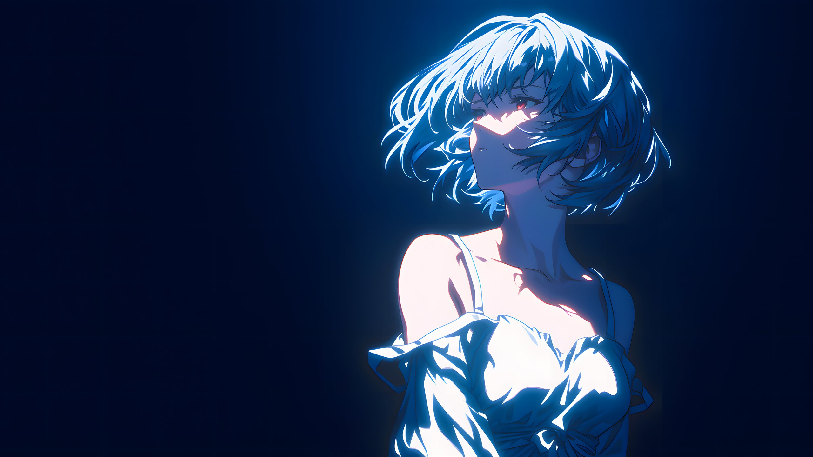
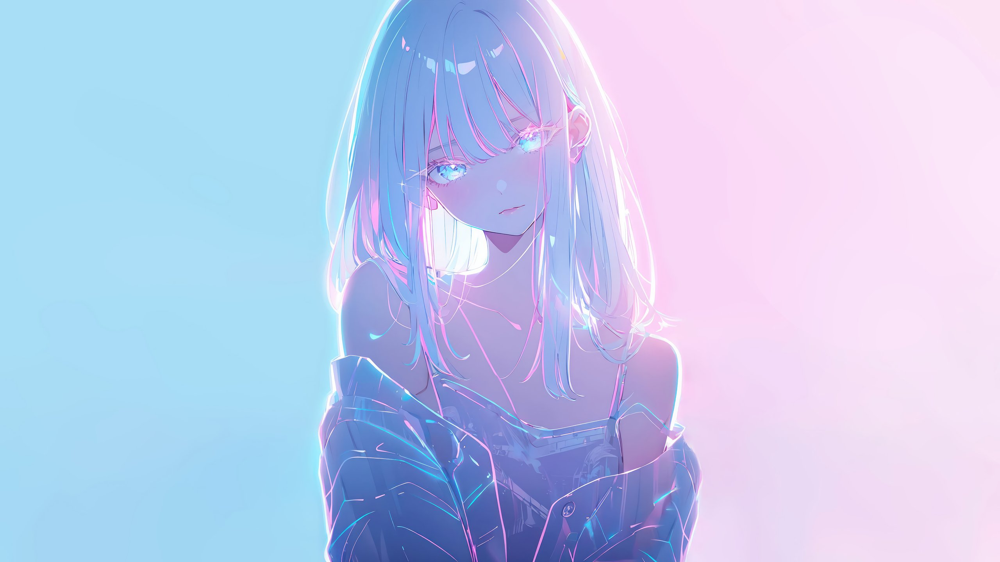

# mini-term 皮肤库

这里是**成品皮肤**，下载即装，不用改一个字。

> 你多半是从 **设置 → 外观 → 主题与语言 → 外置皮肤 → 「更多皮肤」** 跳过来的。挑一份下载，回应用里导入即可。
> 想**自己做**一份皮肤，字段说明在 [`docs/theme-pack-example/`](../docs/theme-pack-example/)（那边是模板，这边是成品）。

---

## Blue Hour 蓝调时分



深紫蓝底 + 冷蓝人像氛围图 + 余烬橙 accent，暗色皮肤。终端与面板半透明压在氛围层上。

**📦 [下载 blue-hour.zip](https://github.com/dreamlonglll/mini-term/raw/main/theme/blue-hour.zip)（211 KB）** · [看包内文件](blue-hour/)

---

## Morning Mist 晨雾



浅紫白底 + 蓝粉双色人像氛围图 + 深余烬 accent，浅色皮肤。面板与终端开得更透，氛围图清楚可见；次要文字与 ANSI 配色已按这张图压深，压在人物深色外套上也读得清。

**📦 [下载 morning-mist.zip](https://github.com/dreamlonglll/mini-term/raw/main/theme/morning-mist.zip)（204 KB）** · [看包内文件](morning-mist/)

---

## 雨光


深蓝灰面板 + 冷青色 accent + 暖金色提示，深色皮肤。

**📦 [下载 雨光.zip](https://github.com/dreamlonglll/mini-term/raw/main/theme/%E9%9B%A8%E5%85%89.zip)（812 KB）** · [看包内文件](%E9%9B%A8%E5%85%89/)

---

## 暮紫鎏金


深梅紫底色 + 香槟金 accent + 柔白文字，配沉入暮色的粉金云海，深色皮肤。与「暮霞云歌」同一张图。

**📦 [下载 暮紫鎏金.zip](https://github.com/dreamlonglll/mini-term/raw/main/theme/%E6%9A%AE%E7%B4%AB%E9%8E%8F%E9%87%91.zip)（1044 KB）** · [看包内文件](%E6%9A%AE%E7%B4%AB%E9%8E%8F%E9%87%91/)

---

## 霜蓝听雪


深雾蓝 + 银白 + 冰蓝，柔和的深色皮肤。

**📦 [下载 霜蓝听雪.zip](https://github.com/dreamlonglll/mini-term/raw/main/theme/%E9%9C%9C%E8%93%9D%E5%90%AC%E9%9B%AA.zip)（787 KB）** · [看包内文件](%E9%9C%9C%E8%93%9D%E5%90%AC%E9%9B%AA/)

---

## 霜刃紫焰


深蓝黑打底，冰蓝为主、紫焰为辅，深色皮肤。与「银灰机能」同一张图。

**📦 [下载 霜刃紫焰.zip](https://github.com/dreamlonglll/mini-term/raw/main/theme/%E9%9C%9C%E5%88%83%E7%B4%AB%E7%84%B0.zip)（606 KB）** · [看包内文件](%E9%9C%9C%E5%88%83%E7%B4%AB%E7%84%B0/)

---

## 晨曦云庭


晨曦蓝紫天空、云海倒影、浮空圣城与白发精灵，浅色幻想皮肤。

**📦 [下载 晨曦云庭.zip](https://github.com/dreamlonglll/mini-term/raw/main/theme/%E6%99%A8%E6%9B%A6%E4%BA%91%E5%BA%AD.zip)（1377 KB）** · [看包内文件](%E6%99%A8%E6%9B%A6%E4%BA%91%E5%BA%AD/)

---

## 暮霞云歌


银发精灵在云端吹奏金色长笛，粉金霞光映照白色石柱与云海，浅色幻想皮肤。

**📦 [下载 暮霞云歌.zip](https://github.com/dreamlonglll/mini-term/raw/main/theme/%E6%9A%AE%E9%9C%9E%E4%BA%91%E6%AD%8C.zip)（1045 KB）** · [看包内文件](%E6%9A%AE%E9%9C%9E%E4%BA%91%E6%AD%8C/)

---

## 澄空清吟


冰白 + 晴蓝 + 银灰，浅色皮肤。

**📦 [下载 澄空清吟.zip](https://github.com/dreamlonglll/mini-term/raw/main/theme/%E6%BE%84%E7%A9%BA%E6%B8%85%E5%90%9F.zip)（523 KB）** · [看包内文件](%E6%BE%84%E7%A9%BA%E6%B8%85%E5%90%9F/)

---

## 银灰机能


银白底色 + 石墨灰文字 + 冰蓝选区与冷蓝 accent，浅色皮肤。

**📦 [下载 银灰机能.zip](https://github.com/dreamlonglll/mini-term/raw/main/theme/%E9%93%B6%E7%81%B0%E6%9C%BA%E8%83%BD.zip)（606 KB）** · [看包内文件](%E9%93%B6%E7%81%B0%E6%9C%BA%E8%83%BD/)

---

## 怎么装

### 最快：下 zip → 「导入 zip」

1. 点上面想要的那份 **下载 xxx.zip**（浏览器直接开始下载）；
2. 回到 mini-term：设置 → 外观 → 主题与语言 → 外置皮肤 → **「导入 zip」**，选中刚下的文件；
3. 列表里出现卡片，点一下就应用了。

### 或者：拿到文件夹 → 「添加皮肤」

GitHub 网页没法单独下载一个子目录，所以走文件夹得先把仓库弄到本地 —— 整仓 **Download ZIP**，或者：

```bash
git clone --depth 1 https://github.com/dreamlonglll/mini-term.git
```

然后 **「添加皮肤」** 选中 `theme/` 下对应的那个文件夹（如 `theme/blue-hour/`，里面得有 `theme.json`）。

### 或者：直接丢进皮肤目录

把皮肤文件夹整个拷进皮肤目录，回界面点「刷新」。目录位置见 **「打开皮肤目录」** 按钮，Windows 上是：

```
%APPDATA%\com.mini-term.app\themes\
```

> ⚠️ **皮肤 id = 文件夹名**，不是 `theme.json` 里的 `id` 字段 —— 两者不一致时一律以文件夹名为准。
> 装之前给文件夹改名，等于改了这份皮肤的 id；已经装过同名皮肤的话会被顶掉。

## 装完想调

这些皮肤都带背景图，所以终端和面板会**半透明地压在氛围图上**。嫌太透或太暗，直接改皮肤目录里的 `theme.json` —— **保存即热重载**（目录监听 300ms 防抖），不用重启：

| 想改什么 | 改哪个 |
|---|---|
| 终端透明度 | `effects.terminalOpacity`（0–1，越小越透） |
| 侧栏 / 面板透明度 | `effects.surfaceOpacity` |
| 背景图压暗程度 | `effects.backgroundDim`（越大越暗；纱罩取皮肤底色，浅色皮肤里是白纱，越大越淡） |
| 人物在视口里的位置 | `art.focusX` / `art.focusY`（0–1） |
| 配色 | `colors` 十个语义色、`terminal` 的 ANSI 配色 |

字段的完整含义见 [`docs/theme-pack-example/README.md`](../docs/theme-pack-example/README.md)。

---

## 几件值得知道的事

**包里没有 `theme.css`，这是故意的。** `theme.css` 与 `tokens` 是 Tauri + WebView 时代的机制，靠浏览器 CSS 引擎生效。GPUI 原生版没有 CSS 引擎，这两项**已无任何消费方** —— 写了不报错，但一行也不会生效。现在真正生效的是 `theme.json` 里的 `colors` / `appearance` / `image` / `art` / `effects` / `terminal`。

**`manifest.json` 与换行。** 有 manifest 时导入会逐文件核对 `bytes` + `sha256`，防包在下载途中损坏。Blue Hour 与 Morning Mist 只登记二进制的背景图；后来加入的八份把 `theme.json` 与 `README.md` 也登记了。Git 在签出时可能按平台改写文本换行（`core.autocrlf`），字节数与哈希会跟着变，所以仓库根的 `.gitattributes` 让 `theme/` 各皮肤目录里的文件一律按二进制原样存取 —— clone 下来的文件夹和 zip 都与登记的一致。自己做皮肤时仍建议只登记二进制文件：文本损坏本来也会在 JSON 解析阶段直接报错。

**zip 与文件夹是同一份东西。** 两者的 `theme.json` 与背景图逐字节对齐，有测试钉着，不会漂开 —— 走哪条路装都一样。

**背景图。** `blue-hour/background.jpg` 是 2560×1440 / JPEG q85（231 KB），由 3840×2160 的 PNG 原图压制：背景要被 `backgroundDim` 压暗、还要被面板盖掉大半，原图那 6.9 MB 进 Git 不划算，观感上分辨不出差别。这张图随皮肤一起分发，**出处尚未注明** —— 仓库以 MIT 发布，但 MIT 覆盖的是代码，图片素材需要单独说明来源与许可。在补上之前，请勿把它当作可自由再分发的素材；如果你是版权方，欢迎开 issue 告知。

`morning-mist/background.jpg` 同样是 2560×1440 / JPEG q85（209 KB），由 3840×2160 的 PNG 原图压制，已确认可随皮肤一起再分发。

雨光、暮紫鎏金、霜蓝听雪、霜刃紫焰、晨曦云庭、暮霞云歌、澄空清吟、银灰机能八份的背景图在 500 KB 到 1.4 MB 之间，原图文件名、裁切方式与焦点设置写在各自包内的 `README.md` 里。这些图片的**作者与再分发许可都尚未确认**，权利归原权利人，请勿把它们当作可自由再分发的素材；如果你是版权方，欢迎开 issue 告知。
